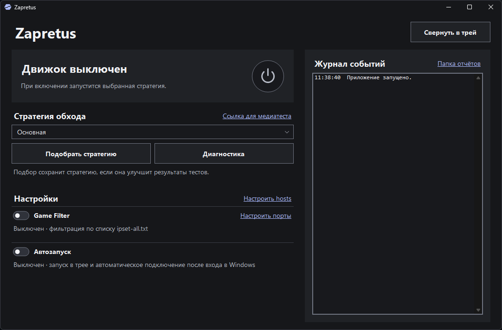

# Zapretus

Приложение для Windows с интерфейсом на русском языке, подбором стратегии подключения и дополнительными настройками.

Текущая версия — **0.2.0**. Скачайте ZIP для Windows x64 в разделе [Releases](https://github.com/Evgexa70001/Zapretus/releases/latest). Он содержит готовое приложение и необходимые файлы.



## Первый запуск

1. Распакуйте скачанный архив в удобную папку. Перед запуском извлеките все файлы из архива.
2. Откройте папку `dist` и запустите **`Zapretus.exe`**. Если Windows запросит права администратора, подтвердите запуск.
3. Нажмите **«Подобрать стратегию»** и дождитесь завершения проверки. Полный подбор может занять 10–15 минут.
4. Если приложение найдёт стратегию с подтверждённым улучшением, оно автоматически выберет её и сохранит **по умолчанию**. Результат появится под списком стратегий и в журнале. Если улучшение не найдено, прежний выбор сохранится.
5. Нажмите **кнопку питания справа от статуса движка**, чтобы включить подключение с выбранной стратегией.
6. Проверьте работу нужных сервисов: например, воспроизведите видео на YouTube и подключитесь к голосовому каналу Discord.

При следующем запуске приложение восстановит сохранённую стратегию. При обычном ручном запуске подключение нужно включить кнопкой питания.

> Сохраняйте содержимое папки `dist` вместе: приложению нужны папка `engine` и файлы профилей рядом с `Zapretus.exe`. Перед подбором выключите подключение в приложении и остановите другие запущенные версии zapret.

## Дополнительные настройки

### Файл hosts

Нажмите **«Настроить hosts»** в разделе **«Настройки»**. При каждом открытии Zapretus загружает [полный список Flowseal для Discord, Telegram и GitHub](https://github.com/Flowseal/zapret-discord-youtube/blob/main/.service/hosts). Если загрузка не удалась, будут доступны встроенные записи для Discord из Flowseal 1.10.4.

1. Нажмите **«Скопировать строки»**, затем **«Открыть hosts»**.
2. Вставьте блок в конец файла. При обновлении полного списка замените прежний блок Zapretus, включая старый блок `Zapretus Discord`, если он есть.
3. Нажмите **Ctrl+S** и заново откройте нужный сервис.

Чтобы отменить правку, удалите добавленный блок вместе со строками с пометками Zapretus и сохраните файл. Оригинал можно открыть по ссылке **«Список на GitHub»** в том же окне.

### Game Filter

Переключатель **Game Filter** включает обработку игрового трафика для адресов из списка `engine/lists/ipset-all.txt`. Через **«Настроить порты»** можно выбрать протокол TCP, UDP или TCP + UDP и указать нужные порты.

Чтобы изменить настройки, выключите подключение, настройте фильтр и снова включите подключение. Подбор стратегий учитывает текущие настройки Game Filter.

По умолчанию Game Filter выключен. Сам переключатель не добавляет адреса игровых сервисов в список: если нужных адресов в нём нет, их потребуется добавить отдельно.

### Автозапуск

Включите переключатель **«Автозапуск»**, чтобы приложение запускалось автоматически после входа в вашу учётную запись Windows. Оно откроется в трее и включит сохранённую стратегию с текущими настройками Game Filter.

Если вы перенесли папку приложения, запустите `Zapretus.exe` из нового расположения и обновите привязку автозапуска через **«Привязать эту версию»**.

### Работа в трее

При сворачивании приложение остаётся в трее — области значков рядом с часами Windows. Подключение продолжает работать. Чтобы открыть окно, дважды нажмите на значок приложения или выберите **«Открыть»** в его меню.

Для завершения работы выберите **«Выключить и выйти»** в меню значка. Закрытие окна также отключает подключение и завершает приложение.

## Если подключение не работает

- Убедитесь, что подключение включено кнопкой питания. Завершение подбора само по себе его не включает.
- Повторите подбор стратегии: результат зависит от провайдера и текущих условий сети.
- Проверьте журнал в окне приложения. Настройки, журналы и отчёты подбора сохраняются в `%LOCALAPPDATA%\Zapretus`.

Автоматические проверки помогают выбрать стратегию, но работу видео, игр и голосовой связи стоит проверить вручную.

## Техническая информация

Приложение предназначено для Windows x64 и использует .NET Framework 4.8. Движок — winws / WinDivert из Flowseal/zapret-discord-youtube.

Исходный код интерфейса распространяется по лицензии MIT — см. `LICENSE`. Уведомления и лицензии сторонних компонентов находятся в `engine/LICENSE.txt` внутри папки `dist`.

Приложение использует движок из [Flowseal/zapret-discord-youtube 1.10.4](https://github.com/Flowseal/zapret-discord-youtube/releases/tag/1.10.4) и не является официальным релизом Flowseal. Исходники зависимостей: [zapret](https://github.com/bol-van/zapret) и [WinDivert](https://github.com/basil00/WinDivert).

## Сборка из исходников

Нужны Windows x64, .NET Framework 4.8 и Python 3. Выполните из папки проекта:

```powershell
powershell -NoProfile -ExecutionPolicy Bypass -File scripts/build.ps1
```

Скрипт скачает закреплённую версию движка, проверит SHA-256 архива и соберёт `dist/Zapretus.exe`. Готовые бинарные файлы распространяются через Releases, а не хранятся в Git.

Автономные проверки:

```powershell
powershell -NoProfile -ExecutionPolicy Bypass -File scripts/test-offline.ps1
```

Сетевые тесты запускаются отдельно и требуют прав администратора: `scripts/test-network.ps1`. Перед их запуском выключите подключение в приложении. Результаты проверки трёх стратегий приведены в [отчёте](docs/STRATEGY-TESTS.md).
